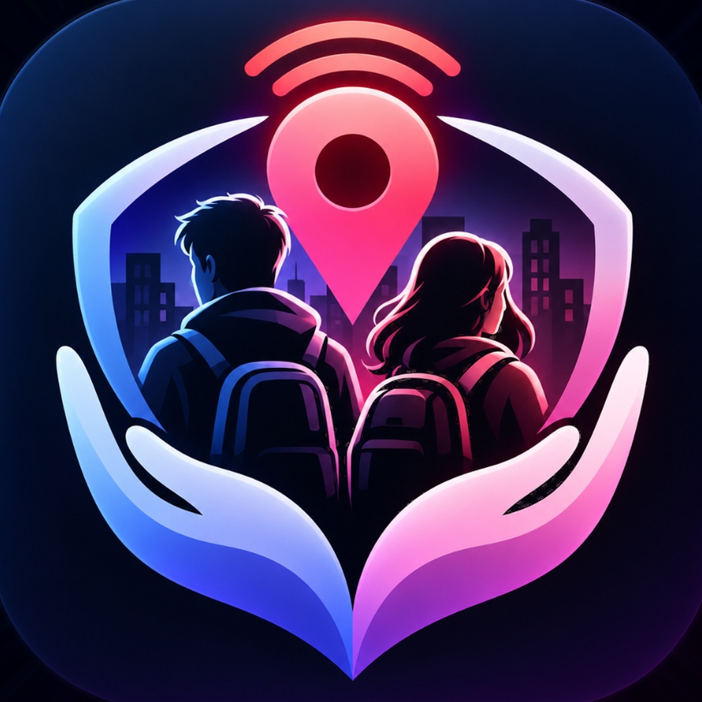
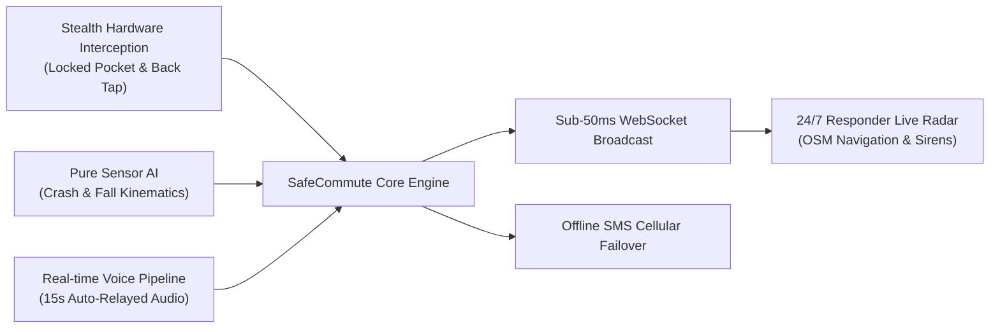
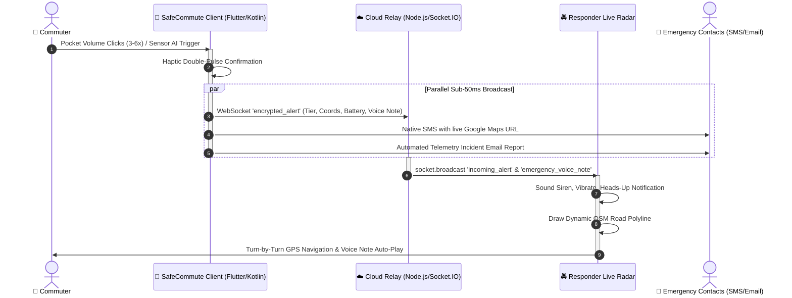

<p align="center">
  
</p>

<h1 align="center">SafeCommute 🛡️</h1>

<p align="center">
  <strong>An AI-Powered Active Defense & Emergency Response Platform for Commuters</strong>
</p>

<p align="center">
  <a href="https://flutter.dev/"></a>
  <a href="https://kotlinlang.org/"></a>
  <a href="https://nodejs.org/"></a>
  <a href="https://socket.io/"></a>
  <a href="https://render.com/"></a>
  <a href="#-intellectual-property--code-access"></a>
</p>

---

## 📌 Executive Summary

**SafeCommute** is an active defense ecosystem built to protect commuters during high-risk urban transit. The platform bridges the critical latency gap between victims in distress, their emergency contacts, and nearby community responders by pairing sub-50ms cloud WebSockets with native Android hardware interception, on-device sensor AI, and an offline cellular SMS failover.

> [!NOTE]
> **Source Code Availability:** Developed as an engineering internship and academic capstone project. In accordance with organizational intellectual property agreements, the core implementation codebase is hosted in a private repository. This showcase presents the product architecture, engineering solutions, telemetry pipelines, and technical roadmap.

---

## 🚀 Core Engineering Innovations



### 1. 🔘 Stealth Pocket & Locked-Screen Hardware Interception
- **Accessibility Service Interception:** Custom native Kotlin engine monitors volume key press patterns while the device remains **locked inside a pocket**, bypassing screen wake-up and biometric prompts.
- **Dynamic Priority Tier Escalation:**
  - `3 Clicks`: **Tier 1 (Elevated Panic SOS)**
  - `4–5 Clicks`: **Tier 2 (Urgent Danger)**
  - `6+ Clicks`: **Tier 3 (Critical / Violent Attack)**
- **Apple iPhone-Style Back Tap:** Calibrated Z-axis accelerometer wavelet filtering that detects deliberate double-tap patterns on the back of the device.

### 2. 🧠 On-Device Autonomous Sensor AI
- **🚗 Vehicle Crash Detection:** Instantaneous impact deceleration ($\ge 3.2\text{ G}$) verified against sudden drop in GPS Doppler speed.
- **⚠️ Hard Fall Detection:** Freefall zero-G vector ($< 0.3\text{ G}$) followed immediately by high-impact floor deceleration ($> 2.6\text{ G}$).
- **🥊 Violent Struggle / Assault:** Kinetic frequency analysis detecting erratic multi-axis kinetic tremors characteristic of physical altercation.
- **Automated Incident Email Reports:** Generates an HTML incident report with peak G-forces, estimated impact speed, coordinates, and classification sent to emergency contacts upon countdown timeout.

### 3. 🎙️ Real-Time Emergency Voice Explanation Pipeline
- Commuters can record a **15-second emergency voice note** explaining their situation (*"Car broke down near dark alley"*, *"Followed by two men"*).
- **Audio State Preservation:** Custom telemetry streaming ensures voice payloads are not wiped out or overwritten during continuous 4-second GPS coordinate refreshes.
- **Responder Notification Action:** Responders receive an actionable Android heads-up notification:
  > **🎙️ EMERGENCY VOICE: [Victim] Sent Audio!**  
  > *[Victim] recorded an explanation (15s). Tap to listen now!*  
  > Actions: `[▶️ LISTEN TO VOICE]` | `[STOP ALARM]` | `[VIEW LIVE RADAR]`

### 4. 🗺️ Dual-Role Live Radar & 24/7 Background Alert Shield
- **1-Tap Role Transition:** Users seamlessly switch between **Commuter Mode** and **Responder Mode** without complex account logins.
- **100% Free OpenStreetMap Engine:** Zero proprietary API key watermarks, utilizing high-contrast Humanitarian (HOT) and OSM-FR road layers.
- **Live Dynamic Turn-by-Turn Guidance:** Dynamic polyline vectors connecting responder to victim with real-time distance readouts (*"380 m away"*) and 1-tap Google Maps external dispatch.
- **24/7 Background Alert Shield:** Kotlin foreground service monitors emergency broadcasts even when the app is completely closed or the phone is asleep, sounding sirens and triggering heavy haptic vibrations.

### 5. 📩 Offline Cellular SMS Failover
- When mobile data or Wi-Fi is unavailable, the device automatically falls back to physical cellular SIM dispatch via native Android `SmsManager`.
- Dispatches emergency coordinates with clickable Google Maps links directly to primary emergency contacts.

---

## 🏗️ System Architecture & Data Flow



---

## 💻 Complete Technology Stack

| Layer | Technologies & Libraries |
| :--- | :--- |
| **Mobile Frontend** | Flutter 3.47, Dart, `flutter_map` (OSM), `latlong2`, `geolocator`, `sensors_plus`, `audioplayers`, `battery_plus`, `permission_handler` |
| **Native Android Layer** | Kotlin, Android `AccessibilityService`, `SmsManager`, `MediaRecorder` (AAC/3GP AMR-NB fallback), `NotificationManagerCompat` |
| **Backend & Cloud** | Node.js, Express, Socket.IO WebSockets, Render Cloud Infrastructure |
| **Geospatial & Mapping** | OpenStreetMap (OSM-FR, Humanitarian HOT), Haversine Distance Geometry |
| **Hardware (Phase 3)** | Seeed Studio XIAO ESP32-C3, 24GHz mmWave Radar (LD2410), Magnetic Breakaway Clasp |

---

## 📿 Phase 3 Roadmap: Wearable Jewelry Integration

SafeCommute is currently expanding from software defense into discrete personal wearable electronics:

```mermaid
flowchart TD
    subgraph WEARABLE ["Discreet Pendant / Bracelet Hardware"]
        H1["Concealed Squeeze Switch (Manual Override)"] --> MCU["Seeed Studio XIAO ESP32-C3"]
        H2["Magnetic Breakaway Clasp (Anti-Snatch)"] --> MCU
        H3["24GHz mmWave Radar (Vital Signs & Proximity)"] --> MCU
    end

    MCU -->|BLE 5.0 Beacon (<50ms)| APP["SafeCommute Mobile App"]
    APP --> SOS["🚨 Instant Multi-Tier SOS, GPS & Audio Relay"]

    style H1 fill:#4CAF50,stroke:#2E7D32,color:#fff
    style H2 fill:#FF9800,stroke:#E65100,color:#fff
    style H3 fill:#2196F3,stroke:#1565C0,color:#fff
    style SOS fill:#E53935,stroke:#B71C1C,color:#fff
```

- **Jewelry Form Factor:** Miniature locket pendant or wrist wearable.
- **Thumbnail-Sized Microcontroller:** **Seeed Studio XIAO ESP32-C3** ($21\text{mm} \times 17.5\text{mm}$) with built-in LiPo charging.
- **mmWave Radar Module:** Penetrates clothing/enclosures to detect approaching stalkers and monitor vital chest breathing movements without cameras.
- **Magnetic Breakaway Clasp:** If an attacker pulls or snatches the necklace, the magnetic circuit breaks, firing a Tier 3 Critical SOS automatically.
- **Fail-Safe Squeeze Button:** Dedicated tactile micro-switch directly wired to a hardware interrupt for guaranteed manual dispatch.

---

## 🔒 Intellectual Property & Code Access

**Copyright © 2026. All rights reserved.**

The source code, algorithms, and native architecture of SafeCommute are proprietary under internship agreements and institutional policies. 

### Inquiries & Evaluation Access
If you are an academic evaluator, potential employer, or engineering recruiter interested in a code walkthrough or private demonstration, please connect:
- **Author:** Soumo Naskar
- **GitHub:** [@Mr-Soumo-006](https://github.com/Mr-Soumo-006)
- **Email:** [naskarsimo006@gmail.com](mailto:naskarsimo006@gmail.com)

---

<p align="center">
  <em>SafeCommute — Reimagining personal defense through autonomous sensor intelligence and community solidarity.</em>
</p>
